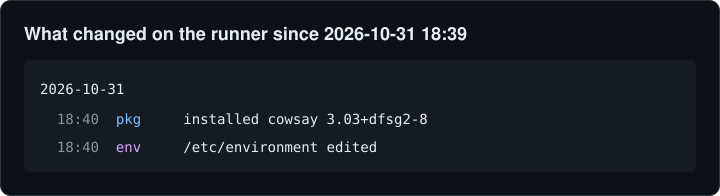

# whatchanged-action

[](https://github.com/marketplace/actions/whatchanged-timeline)
[](https://github.com/majidninja/whatchanged-action/actions/workflows/test.yml)

See what a CI job changed on its runner. This action runs
[whatchanged](https://github.com/majidninja/whatchanged) and puts one timeline
of installed packages, edited `/etc` files, systemd units, cron jobs and shell
startup files into the job summary.

It's useful for:

- checking what a setup script or `apt-get install` step really did
- turning "works in CI but not on my machine" into a list of differences
- reviewing third-party actions that touch the system

## Usage

Mark the start of the job, then report at the end:

```yaml
steps:
  - uses: majidninja/whatchanged-action@v1
    with:
      mode: start

  - uses: actions/checkout@v4
  - run: ./scripts/setup-ci.sh

  - uses: majidninja/whatchanged-action@v1
```

The job summary then shows what the job changed. This is the real output
from this repo's [test workflow](.github/workflows/test.yml), which installs
`cowsay` and appends a line to `/etc/environment`:



Without a `start` step, give a time instead:

```yaml
  - uses: majidninja/whatchanged-action@v1
    with:
      since: 2h
```

## Inputs

| Input     | Default  | Description |
|-----------|----------|-------------|
| `mode`    | `report` | `start` saves the current time; `report` prints the timeline |
| `since`   |          | Start of the timeline (`30m`, `2h`, `1d`, `"2024-05-01 09:00"`). Defaults to the `start` time, or `1h` |
| `version` | `latest` | `latest` release, a release tag (`v0.1.0`), or a branch/commit to build from source |
| `sudo`    | `true`   | Run with sudo when it works without a password, so root-only files can be read |
| `summary` | `true`   | Write the timeline to the job summary |

## Outputs

| Output     | Description |
|------------|-------------|
| `timeline` | Path to a file with the timeline text |
| `changes`  | Number of timeline lines (`0` when nothing changed) |

## Notes

- Linux runners only.
- The action downloads a prebuilt static binary from the
  [whatchanged releases](https://github.com/majidninja/whatchanged/releases)
  and checks its sha256. For a branch or commit `version`, it builds from
  source with `cargo` (Rust 1.85+). Either way the binary is cached.
- Timestamps have minute precision, so changes made in the same minute as
  the `start` step can show up too.

## License

MIT
